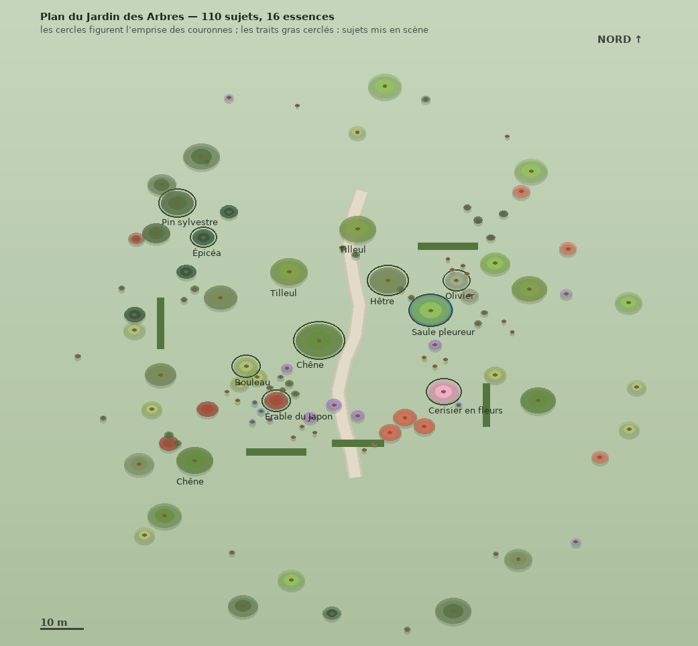
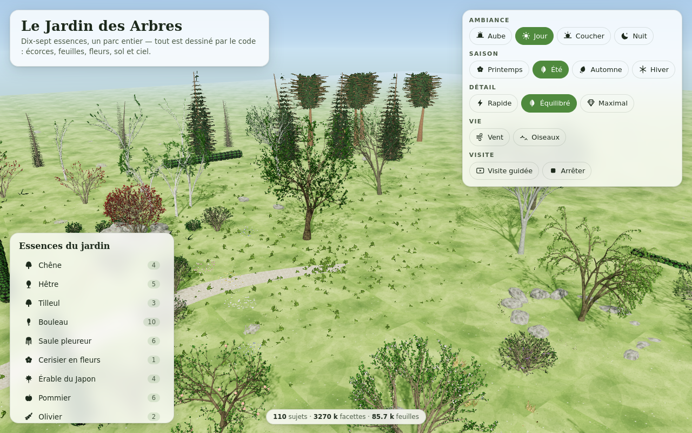
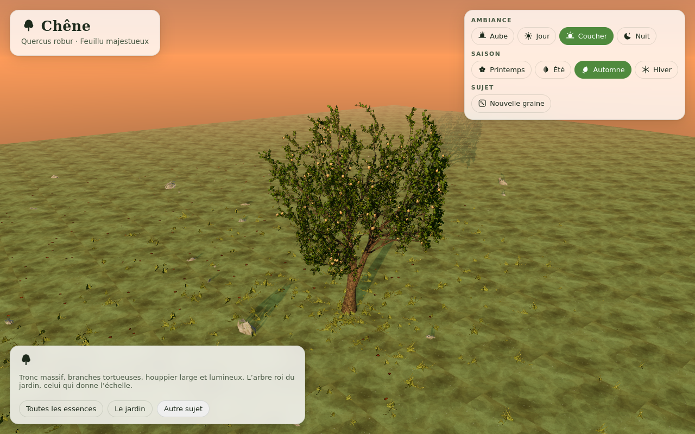

# 🌳 Le Jardin des Arbres

Un **parc 3D entièrement généré par le code** : les arbres, l’écorce, les feuilles, les fleurs,
l’herbe, l’eau et le ciel sont dessinés par des algorithmes, au moment de l’ouverture de la page.
Aucune image téléchargée, aucun modèle 3D importé, aucune bibliothèque en ligne : le site
fonctionne hors connexion, à partir de `three.js` posé à côté des fichiers.

- **Le jardin** — `index.html` : 110 sujets plantés en scènes paysagères (pelouse du chêne,
  pièce d’eau du saule, bosquet de conifères, coin japonais, verger, carré des fleurs, lisière
  boisée à l’horizon).
- **La galerie** — `galerie.html` : les 17 essences présentées une à une, dans un aperçu 3D.
- **Les fiches** — `espece.html?espece=chene` : un sujet unique, examinable sous toutes les
  coutures, avec changement de graine, de saison et d’ambiance.
- **Les modèles d’origine** — `arbre.html`, `cerisier.html`, `epicea.html`, `erable.html`,
  `saule.html` : les cinq scènes d’origine du dépôt, **conservées telles quelles** et reliées
  depuis le jardin et la galerie.



## Aperçu

| Le jardin, été, plein jour | Chêne à l’automne, au couchant |
|---|---|
|  |  |

| Cerisier au printemps | Saule pleureur |
|---|---|
|  |  |

---

## Les 17 essences

| | Essence | Latin | Famille | Port |
|---|---|---|---|---|
| 🌳 | Chêne | *Quercus robur* | Feuillu majestueux | 11,5 m, houppier large, feuilles lobées, glands |
| 🌳 | Hêtre | *Fagus sylvatica* | Feuillu de sous-bois | 12,5 m, écorce lisse, houppier dense |
| 🌿 | Bouleau | *Betula pendula* | Feuillu léger | 10,5 m, écorce blanche à lenticelles, ramilles retombantes |
| 🌳 | Tilleul | *Tilia cordata* | Feuillu d’ombrage | 12 m, feuilles en cœur, floraison parfumée |
| 🍁 | Érable du Japon | *Acer palmatum* | Petit arbre graphique | 5,6 m, port en vase, plusieurs troncs, feuilles palmées pourpres |
| 🌸 | Cerisier en fleurs | *Prunus serrulata* | Arbre de floraison | 7,2 m, floraison rose, pétales, feuillage bronze |
| 🍎 | Pommier | *Malus domestica* | Arbre fruitier | 4,6 m, tronc noueux, pommes et fleurs |
| 🫒 | Olivier | *Olea europaea* | Méditerranéen | 5,4 m, tronc torsadé, feuillage argenté |
| 🌿 | Saule pleureur | *Salix babylonica* | Arbre pleureur | 8,4 m, branches en cascade |
| 🌲 | Cyprès | *Cupressus sempervirens* | Conifère colonnaire | 8,5 m, flèche végétale |
| 🌲 | Épicéa | *Picea abies* | Conifère de futaie | 14 m, cône régulier, cônes pendants |
| 🌲 | Pin sylvestre | *Pinus sylvestris* | Conifère parasol | 12,5 m, tronc nu couleur cannelle |
| 💜 | Lilas | *Syringa vulgaris* | Arbuste de floraison | 3,2 m, grappes parfumées |
| 💠 | Hortensia | *Hydrangea macrophylla* | Arbuste de massif | 1,5 m, grosses ombelles bleues |
| 🌿 | Fougère | *Dryopteris filix-mas* | Sous-bois | 1 m, frondes arquées |
| 🌾 | Cheveux d’ange | *Stipa tenuissima* | Graminée | 1 m, touffe blonde |
| 🧱 | Buis taillé | *Buxus sempervirens* | Haie et topiaire | volume net taillé au cordeau |

## Ce qui rend chaque arbre vivant

- **Écorces procédurales** — cinq signatures distinctes (sillons profonds du chêne, plaques du pin,
  écailles de l’épicéa, lenticelles du bouleau, peau lisse du hêtre, fibre torsadée de l’olivier),
  avec mousse, lichen et relief (`bumpMap`) : la même texture sert de carte de couleur et de relief.
- **Feuilles dessinées une par une** — limbe, nervures, pétiole, morsures d’insecte, duvet argenté,
  reflet cireux… puis des milliers d’exemplaires sont semés par instanciation.
- **Silhouettes contraintes par une enveloppe** — les branches poussent vers la lumière mais restent
  contenues dans un ellipsoïde : chaque essence atteint naturellement sa forme (bouquet du chêne,
  colonne du cyprès, ombrelle du pin).
- **Vent cohérent** — le même souffle déplace l’écorce, les feuilles, les aiguilles et les fleurs
  (shader injecté dans les matériaux), pour qu’elles ne se séparent jamais.
- **Saisons** — floraison au printemps, feuillages d’été, teintes d’automne, branches nues et sol
  jonché de feuilles en hiver.
- **Ambiances** — quatre ciels dessinés par shader (aube, plein jour, coucher, nuit étoilée) ; le
  soleil, la brume, l’exposition et la couleur de l’eau suivent.
- **Les pieds sur terre** — chaque sujet est posé à la hauteur exacte du terrain (la même
  fonction sert à déformer le sol et à planter), et une ombre douce de contact l’ancre au sol
  même quand la carte d’ombres est grossière.
- **Détail adaptatif** — la construction se fait par paliers (le jardin « pousse » sous les yeux) et
  le niveau de détail décroît avec la distance : sujet héros, moyen, fond, lisière.
- **Icônes vectorielles maison** — chaque pictogramme de l’interface (essences, saisons, ambiances,
  commandes) est un tracé SVG écrit dans `arbres-ui.js` : aucun émoji, donc aucune police exotique
  requise et un rendu identique sur tous les systèmes.

## Structure du dépôt

```
index.html        Le jardin interactif (page principale)
galerie.html      Catalogue des essences
espece.html       Fiche + modèle 3D d’une essence
arbre.html …      Anciennes pages : redirigent vers leur fiche
arbres-core.js    Cœur procédural : textures, géométrie, générateur d’arbres, catalogue
arbres-ui.js      Moteur de scène : ciel, lumières, terrain, eau, vent, caméra, interface
jardin.js         Plan de plantation et décor du jardin
arbres.css        Habillage
three.min.js      three.js r137 (local, aucune dépendance réseau)
test/             Harnais de test hors navigateur (voir « Vérifier »)
test/icones.html  Planche de contrôle des icônes vectorielles
test/navigateur/  Captures dans un vrai Chromium (WebGL) : test/navigateur/captures.js
docs/             Plan du jardin et documents
```

## Visiter

- **Glisser** : tourner autour de la scène · **molette / pincer** : zoomer
- **Cliquer un arbre** : sa fiche · **flèches** : pivoter · **`V`** : visite guidée des sujets
  mis en scène
- **Ambiance**, **saison**, **détail** et **vie** (vent, oiseaux) se règlent depuis la barre d’outils

## Vérifier

Le dépôt contient un harnais de test qui construit tout hors navigateur (faux DOM, faux WebGL) :

```bash
node test/smoke.js                     # catalogue, 17 essences, jardin complet, ambiances, interactions
node test/pages.js                     # exécute le script de chaque page et vérifie sa scène
node test/plan.py                      # redessine le plan du jardin (docs/plan-jardin.png)
node test/harness.js chêne saule       # exporte des maillages …
python3 test/render.py chêne saule     # … puis les met en images (rendu logiciel maison)
```

`test/render.py` est un petit moteur de rendu logiciel : il découpe les textures procédurales,
applique un éclairage simplifié et produit des images de contrôle — c’est ce qui a permis de
corriger les silhouettes sans navigateur.

## Comment ça pousse

1. `CREER` le catalogue (`arbres-core.js`) décrit chaque essence : dimensions, port, écorce,
   feuille, fruits, fleurs.
2. Le **squelette** pousse récursivement : chaque génération de branches mesure une fraction de la
   couronne et s’arrête à la surface de l’enveloppe. Les pousses terminales se multiplient aux
   derniers niveaux.
3. Les branches deviennent des **tubes** à repères transportés parallèlement (pas de vrillage),
   fusionnés en un seul maillage, avec occlusion ambiante et mousse cuites dans les couleurs.
4. Le **feuillage** est semé le long des rameaux, en privilégiant la périphérie de la couronne —
   là où est la lumière — puis instancié (une seule passe de dessin).
5. Le **vent** et les **saisons** modifient shaders, couleurs et densités au moment du rendu.

Tout est déterministe : une graine suffit à reproduire un arbre à l’identique, et « Autre sujet »
en tire un nouveau à la volée.
